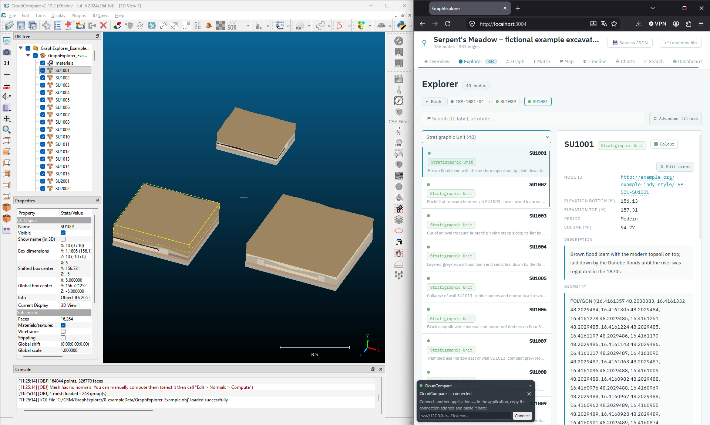
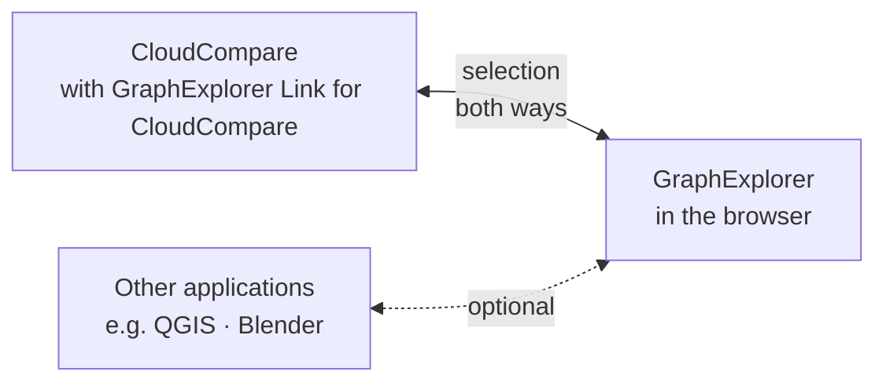
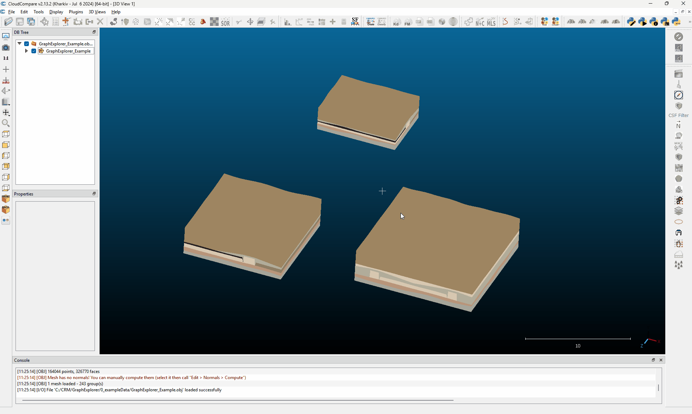
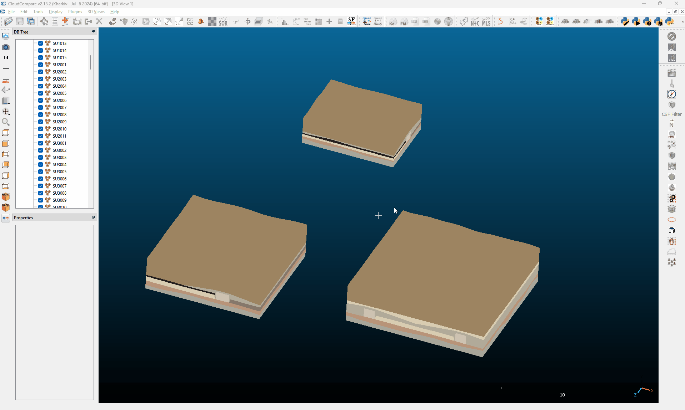
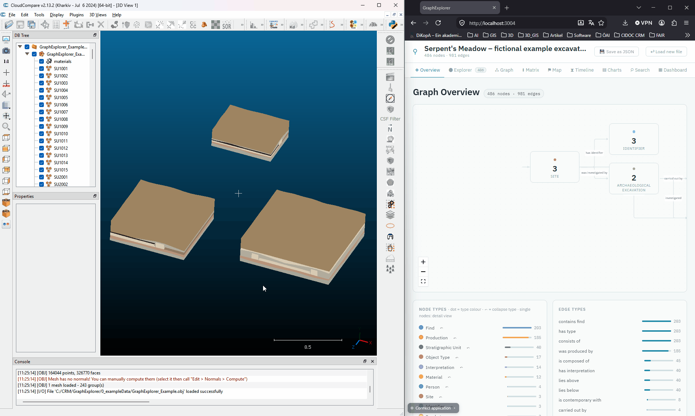
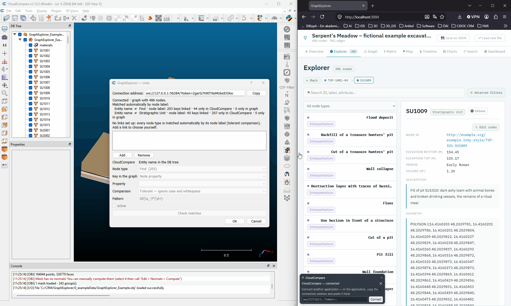

<p align="center">
  <strong>GraphExplorer Link for CloudCompare — your point clouds and meshes and your knowledge graph, side by side and in sync.</strong><br>
  Click an entity in CloudCompare and the <a href="https://github.com/oeai-dac/GraphExplorer">GraphExplorer</a> shows everything the graph knows about it.<br>
  Click something in the GraphExplorer and the matching entities are selected in CloudCompare.<br>
  No server, no extra software, and your data never leaves your computer.
</p>

<p align="center">
  
  
  
  
</p>

<p align="center">
  
</p>

---

## What does it do?

Excavation data usually lives in several places — this script connects two of them:

- the **3D data** in CloudCompare — e.g. a point cloud or a mesh for each stratigraphic unit, a marker for each find;
- the **knowledge** in a knowledge graph — e.g. what a unit contains, what lies above it, how it is dated, what a find is made of.

**GraphExplorer Link for CloudCompare** connects the two. All it needs is that your entities in CloudCompare are named like the things in the graph — for example, the mesh of the stratigraphic unit *SU1001* is called `SU1001`. From then on:

- **Click an entity in CloudCompare** → the GraphExplorer opens that unit, with all its finds, its dating and its neighbours in the stratigraphy.
- **Click on a linked node in the GraphExplorer** — in its lists, the Harris matrix or the timeline etc. → the linked entities are selected in CloudCompare.

If the names match exactly, this works without any setup: the script links every kind of node whose names it finds in CloudCompare. If they are written differently, you set up the links yourself in a small dialog.

The graph itself is shown in the **[GraphExplorer](https://github.com/oeai-dac/GraphExplorer)**, a free tool that runs in your web browser. This script connects CloudCompare to it. The same GraphExplorer can be connected to other applications at the same time — such as QGIS or Blender with **[GraphExplorer Link for QGIS](https://github.com/oeai-dac/GraphExplorer_QGIS)** and **[GraphExplorer Link for Blender](https://github.com/oeai-dac/GraphExplorer_Blender)** — so a click in one program updates all the others.



> **New to knowledge graphs?** The [GraphExplorer README](https://github.com/oeai-dac/GraphExplorer#new-to-knowledge-graphs) explains the few terms you need — *node*, *connection*, *attribute* — in plain words.

### Features

- **Selection in both directions** — CloudCompare → graph and graph → CloudCompare, live
- **Works without setup** — if your entities carry the same names as the nodes, they are linked automatically
- **Works with your entity names** — matched against the name, a property or the ID of the nodes
- **Forgiving matching** — ignores upper/lower case, extra spaces, file extensions such as `.obj` or `.las` and the ` - Cloud` / ` - Mesh` CloudCompare adds; can also match `SE 2001` with `2001`.
- **One file or many** — works with one file per unit as well as with one OBJ file that contains all units as separate parts
- **Several links side by side** — e.g. one for the units and one for the finds
- **Match report** — shows which names appear in both, which only in CloudCompare and which only in the graph
- **Clever selection** — click a find in the GraphExplorer, and CloudCompare selects the unit it was found in
- **CloudCompare 2.13 on Windows, the Flatpak version on Linux**, with its Python plugin — no compiling, no extra installation

---

## Installation

### What you need

- **CloudCompare** with its **Python plugin**. You can check: if there is a *Python Plugin* entry in CloudCompare's *Plugins* menu, you are set.
  - **Windows:** CloudCompare **2.13**. The installer offers the Python plugin as an option — make sure it is ticked during the installation process. Otherwise you can also install the *Python Plugin* afterwards from https://github.com/tmontaigu/CloudCompare-PythonRuntime.
  - **Linux:** the Flatpak version from [Flathub](https://flathub.org/apps/org.cloudcompare.CloudCompare) (`flatpak install flathub org.cloudcompare.CloudCompare`). It already includes the Python plugin.
  - **CloudCompare 2.14 (beta) on Windows** does not yet include the Qt bindings for Python that the script needs, so the script does not run there yet.
- The **[GraphExplorer](https://github.com/oeai-dac/GraphExplorer#installation)** — installed, or simply its single standalone HTML file. The script does not include its own copy: it connects to the GraphExplorer you already use.

### Get the script

On the [GitHub page](https://github.com/oeai-dac/GraphExplorer_CloudCompare), click **Code → Download ZIP** and unzip it into a folder of your choice — for example `Documents`. The ZIP contains a folder `GraphExplorer_CloudCompare-main`; you can rename it if you like.

If you use Git, you can clone the repository instead:

```
git clone https://github.com/oeai-dac/GraphExplorer_CloudCompare.git
```

Choose a folder you can write to, **not** `C:\Program Files`: the script saves your links in a file next to it.

The folder contains five files that belong together:

| File | Content |
|---|---|
| `graphexplorer_cc_link.py` | the script you run in CloudCompare |
| `config_dialog.py` | the dialog for the links |
| `linking.py` | the matching of names — the same as in the QGIS plugin and the Blender add-on |
| `websocket.py` | the connection to the GraphExplorer — the same as in the Blender add-on |
| `qtcompat.py` | lets the script work with the Qt version of your CloudCompare |

There is nothing to install: CloudCompare runs the script directly. To update, replace the files with the new ones. To remove it, delete the folder.

---

## User Guide

The GraphExplorer comes with a small, **entirely fictional** excavation, *Serpent's Meadow*: two sites, three sondages, 40 stratigraphic units and 203 finds. The same excavation is available as a knowledge graph and as a 3D model, so you can try everything in a few minutes. The files are in the folder `0_exampleData/` of the GraphExplorer. This guide uses them throughout.

### 1. Open the graph in the GraphExplorer

[Start the GraphExplorer](https://github.com/oeai-dac/GraphExplorer#start) and drop `GraphExplorer_Example.json` onto its start page.

### 2. Open your data or the example data in CloudCompare

Open your own data — or, for the example, choose *File → Open* and open `GraphExplorer_Example.obj`. (Keep `GraphExplorer_Example.mtl` in the same folder; it holds the colors.)

CloudCompare loads the file as one entry in the DB tree, with one part per object inside it:

| Entities | Content |
|---|---|
| `SU1001` … `SU3014` | one body per stratigraphic unit, colored by its interpretation |
| `TSP-1001-01` … `WOS-3012-93` | one small marker per find |

Every entity has the same name as its node in the graph: the body `SU1001` is the stratigraphic unit *SU1001* in the GraphExplorer, the marker `TSP-1001-01` is the find *TSP-1001-01*. That is all the script needs.

To have the single entities as own bodies, click on the small arrow and fold out all entities. Then click on the parent mesh and uncheck the box **visible** in the properties-dialog. Do **not** uncheck the box next to the name of the parent mesh as this would "unload" your entire mesh.  
Then select all child meshes, right click on the selection and choose **toggle**. With this, cloud compare shows your child meshes as single entities and you can choose the single meshes as their own. 

<p>
    
</p>

The example model was made for Blender, which expects a different up-axis, so in CloudCompare it lies on its side. This does not affect the link — and with your own data, the orientation is the one you are used to.

### 3. Start the script and connect

In CloudCompare, you can add the Python script `graphexplorer_cc_link.py` once with *Plugins → Python Plugin → Script register → Add script*. Now the script will be available also after a restart.ing CloudCompare. To run the script, simply click on it under *Plugins → Python Plugin → Script register*

<p>
    
</p>

The dialog **GraphExplorer — Links** opens:

| Element | What it does |
|---|---|
| **Connection address** and **Copy** | The address you paste into the GraphExplorer under *Connect application*. It is also copied to the clipboard when the script starts. |
| **Status line** | Shows what the script is waiting for — the GraphExplorer, then a graph — and, once both are there, what has been linked. |
| **List of links** with **Add** / **Remove** | The links you set up yourself ([step 4](#4-link-the-entities-in-cloudcompare-with-the-nodes-in-the-graphexplorer)). Empty means: link automatically. |
| **Node type**, **Key in the graph**, **Property**, **Comparison**, **Pattern** | The settings of the selected link |
| **active** | Switches the selected link off temporarily, without deleting it |
| **Check matches** | Shows which names match for the selected link ([see below](#check-matches)) |
| **OK** / **Cancel** | Saves the links, or discards your changes. The connection stays open in both cases. |

To connect, click **Copy**. Then, in the GraphExplorer, click **Connect application** at the bottom left, paste the address and click **Connect**.

The status line in the dialog now says **Connected · graph with 486 nodes**, and below it, what has been linked.



You can keep the dialog open while you work in CloudCompare, or close it — the connection keeps running until you close CloudCompare. To open the dialog again, run the script again. The connection address stays the same until you close CloudCompare. If the connection drops — for example because you closed the browser tab — paste the same address again.

### 4. Link the Entities in CloudCompare with the Nodes in the GraphExplorer

#### Automatically

As long as you have not set up any links, the script tries **every node type** in the graph and compares the entity names with the **node labels** — the names shown in the GraphExplorer. Every node type with at least one matching name is linked.

With the example data, this is all you need. The status line shows:

```
Matched automatically by node label:
  Entity name ⇄ Stratigraphic Unit · node label: 40 keys linked · …
  Entity name ⇄ Find · node label: 203 keys linked · …
```

#### Setting up links yourself

If the names in CloudCompare are written differently from the labels in the graph, or if you want to choose which node types take part, set up the links yourself. A **link** tells the script: *the names of my entities* are the same as *the names of these nodes in the graph*. Click **Add** to add a link, **Remove** to remove the selected one.

| Field | Meaning |
|---|---|
| **Node type** | Which nodes in the graph the entities belong to, e.g. *Stratigraphic Unit* |
| **Key in the graph** | Where the name is stored in the node: in the **node label** (the name shown in the GraphExplorer — the usual case), in a **node property** (choose it under *Property*) or in the **node ID** |
| **Comparison** | How strictly the names are compared ([see below](#when-the-names-are-written-differently)) |

The CloudCompare side is always the **name of the entity** in the DB tree. File extensions such as `.obj` or `.las` and the suffixes CloudCompare adds — ` - Cloud`, ` - Mesh`, ` - Vertices` — are ignored. If an entity's own name does not match, its parent's name is used: so clicking the mesh inside a file entry `SU1001.ply` still finds *SU1001*.

**Example — link the stratigraphic units:** click **Add** and fill in:

| Field | Choose |
|---|---|
| Node type | *Stratigraphic Unit* |
| Key in the graph | *Node label* |
| Comparison | *Tolerant* (the default) |

Click **Check matches**: **40 keys linked**. Every body has found its unit.

**Example — link the finds as well:** click **Add** again and set up the same for the finds: node type *Find*, key *Node label*. **Check matches**: **203 keys linked**.

Click **OK** to save the links and use them. From now on, only these links count — the automatic linking is off until you remove all links again.



Node types and properties appear under the same names as in the GraphExplorer. Hover over an entry to see its full technical name.

#### Try it out

- **CloudCompare → GraphExplorer:** click the body `SU1001` in the DB tree. The GraphExplorer opens *SU1001*: a flood deposit, lying above *SU1002*, with seven finds.
- **GraphExplorer → CloudCompare:** in the GraphExplorer, click the find *TSP-1001-01* in the list of finds of *SU1001*. CloudCompare selects its marker. The same works from the Harris matrix, the timeline and everywhere else in the GraphExplorer.
- **Clever selection:** set up only the link for the units (or untick *active* for the finds and click **OK**) and click a find of *SU1001* in the GraphExplorer, e.g. *TSP-1001-02*. Now CloudCompare selects the body of *SU1001*: if the clicked node itself has no entity, the GraphExplorer looks at its neighbours (up to two steps away) and uses the nearest linked one — here the unit the find was found in.

Good to know:

- If several entities are selected, the GraphExplorer opens the first matching node — it always shows one node in detail.
- Clearing the selection in CloudCompare leaves the node open in the GraphExplorer. That is intended.
- When you load or rename entities in CloudCompare, the script notices it within about two seconds and matches again.

#### Check matches

**Check matches** shows for the selected link how many names were linked, with details: examples of names from both sides, which names exist **only in CloudCompare**, which **only in the graph**, and where one name belongs to **several entities or nodes**. If nothing matches, the examples show at once how the names differ.

Each link looks at all entities in the DB tree. So in the example, the link for the units lists the 203 find markers as *only in CloudCompare* — they belong to the other link — and the link for the finds lists the 40 bodies. The file entry itself (`GraphExplorer_Example`) appears there as well. That is no error.

The report is useful in its own right: *“12 bodies without a node in the graph, 3 nodes without a body”* tells you something about your data.

#### When the names are written differently

In the example, the names in CloudCompare and in the graph are exactly the same. With your own data, they are often written slightly differently. Choose for each link how strictly the names are compared:

| Comparison | What it does |
|---|---|
| **Tolerant** (default) | Upper/lower case and extra spaces do not matter: `SE  2001` matches `se 2001` |
| **Trim** | Only spaces at the beginning and end are ignored |
| **Exact** | Every character must match |
| **Digits only** | Only the number counts: `SE 2001` matches `2001`. Names with *several* numbers (`Trench 3, SE 2001`) are left out on purpose — guessing could connect a find with the wrong unit. |
| **Last number** | Takes the last number: `T2_SE2004` matches `2004` — useful when the trench is written in front |
| **Pattern** | A search pattern of your own (a regular expression); the part in brackets is compared. The default `SE[\s_-]*(\d+)` finds the number in `SE2004`, `SE 2004`, `SE-2004`, `se_2004` and `T2_SE2004` |

The automatic linking always uses *Tolerant*. For any other comparison, set up the link yourself.

### Several applications at the same time

The GraphExplorer can be connected to several applications at the same time — for example CloudCompare, QGIS (with [GraphExplorer Link for QGIS](https://github.com/oeai-dac/GraphExplorer_QGIS)) and Blender (with [GraphExplorer Link for Blender](https://github.com/oeai-dac/GraphExplorer_Blender)). Click the body of a unit in CloudCompare, and the GraphExplorer opens the unit while QGIS selects its polygon — and the other way round. Copy the connection address in each program and paste them all into the GraphExplorer (*Connect application*, then *Connect another application*). The example data includes the matching GIS layers for QGIS.

### What is saved where

| What | Where |
|---|---|
| Your links | In `links.json` next to the script. They apply to every project you open in CloudCompare on this computer. |
| The graph | Only in the GraphExplorer in your browser — the script does not store it |
| The connection address | Only while CloudCompare is running |

---

## Troubleshooting

**The GraphExplorer shows “not connected” after pasting the address**
Each CloudCompare session has its own address. If you have restarted CloudCompare, run the script again and paste the new address.

**Nothing happens when the script runs, or the dialog does not open**
Look at CloudCompare's console at the bottom of the window. All messages of the script start with `[GraphExplorer]`. If there is no *Python Plugin* in the *Plugins* menu, the Python plugin is not installed — see [What you need](#what-you-need).

**Clicking in the GraphExplorer works, but clicking in CloudCompare does nothing**
The script has not found the graph side of the link — usually because *Key in the graph* does not fit. Open the dialog, select the link and click **Check matches**.

**“No match — entity names and node key do not fit together”**
Compare the examples from both sides under *Show Details…*. Often another **Comparison** (e.g. *Last number* or *Pattern*) or another **Key in the graph** (*Node label* instead of a property) solves it.

**The automatic linking picks up a node type it should not**
The automatic linking takes every node type with at least one matching name — if a type happens to share a name with one of your entities, it is linked too. Set up the links you want yourself: then only those count.

**The GraphExplorer selects something, but nothing happens in CloudCompare**
The GraphExplorer may already have shown that node, in which case nothing changes. Otherwise, check the link with **Check matches**.

**“The GraphExplorer is older than this script expects”**
Update the GraphExplorer to the latest version.

**A second browser tab cannot connect**
Only one GraphExplorer can be connected to CloudCompare at a time — otherwise two tabs would keep changing each other's selection. A new tab replaces the old one.

**Changes to the script have no effect**
The connection keeps running with the code it was started with. Restart CloudCompare and run the script again.

---

## For developers

<details>
<summary><b>How it works: connection, protocol, security</b></summary>

### Python instead of C++

Native CloudCompare plugins are written in C++ and have to be compiled against the exact CloudCompare, Qt and compiler versions they run with. The Python plugin ships Python, Qt bindings for Python and `pycc`, the Python bindings to CloudCompare — everything the link needs.

Which Qt bindings depends on the build: CloudCompare 2.13 for Windows comes with Qt 5 and PyQt5, the Flatpak version for Linux with Qt 6 and PySide6. `qtcompat.py` picks the binding that matches the Qt library CloudCompare has *already loaded* — not simply the first one that can be imported: a binding for the other Qt would bring a second, foreign Qt into the process, which does not see CloudCompare's application. It also smooths over the few differences the script runs into (enums, `exec`). The binding and CloudCompare share the same Qt libraries in one process, so the dialog and the timers created by the script run in CloudCompare's own event loop, and the user interface stays responsive.

### A WebSocket server without Qt

The server (`websocket.py`) uses only Python's standard library — it is the same file as in the Blender add-on. Not every Qt binding includes `QtWebSockets` (in PySide6 it is a separate add-on package), the standard library is always there. The server reads in a background thread and never touches CloudCompare: it puts incoming messages into a queue, and a timer on the main thread picks them up every 50 ms — `pycc` and Qt may only be used from there. One GraphExplorer at a time: while one is connected, further connections are refused.

### Why the GraphExplorer runs in the browser

The script runs a small WebSocket server on `127.0.0.1`, and the GraphExplorer — the bridge is built into it (`src/explorer-bridge.js`) — connects to it. A WebSocket is always opened by the browser; the applications are the servers. This is also why several applications — such as CloudCompare, QGIS and Blender — can share one GraphExplorer without depending on each other.

### Staying alive after the script ends

The script returns as soon as the server is running. The link object is kept in `builtins`, so it outlives the script's namespace; its timers keep running in CloudCompare's event loop, the server in its background thread. Running the script again finds the running link there and opens its dialog instead of starting a second one.

### No “selection changed” signal

`pycc` offers no signal for a changed selection. A timer (every 250 ms) compares the current selection with the last one it saw; every sixth tick it also re-reads the DB tree and matches again if entities were added, removed or renamed. Entities are read fresh each time and never kept between ticks: a Python reference to an entity that was deleted in CloudCompare would point to freed memory.

### Callbacks after the messages

Answers from the GraphExplorer are handled right *after* the messages picked up from the queue, not in the middle of them (`QTimer.singleShot(0, …)`). A callback may open a message box — **Check matches** does — and its event loop would otherwise process further messages while the previous one is unfinished. Every Qt callback is also wrapped so that an exception only ends up in the console: an unhandled exception in a PyQt5 slot would terminate CloudCompare.

### Protocol

The same as the QGIS plugin and the Blender add-on — JSON in both directions, three forms:

```
CloudCompare → Browser    {"id": 7, "method": "collectKeys", "args": [...]}
Browser → CloudCompare    {"id": 7, "result": ...}
Browser → CloudCompare    {"event": "selection", "nodeId": "...", "keys": [...]}
```

For the selection, CloudCompare never sees node IDs, only keys (`SU1001`), so it needs to know nothing about the structure of the graph.

```
CloudCompare                            GraphExplorer (browser)
─────────────────────────────────────────────────────────────────
timer: selection changed?
  → LinkIndex: entity name → key
  → LinkIndex: key → node ID
  → {"method":"selectNodes"}  ───────▶  open the node

                                        selected node changes
                                          → resolve keys (up to 2 hops)
  {"event":"selection"}       ◀───────  send
  → LinkIndex: key → entities
  → setSelectedInDB()
```

### Interface version

On connecting, the GraphExplorer reports an interface version (`API_VERSION` in its `src/main.jsx`). The script checks for **at least** the version it needs (currently 2; version 3 adds the display names), not for exactly that version: the bridge gains methods but never loses any.

### Access token

The server listens only on `127.0.0.1`, but “local” does not mean “only us”: any other program on the computer, and any web page in an open tab, could otherwise connect and read the loaded graph. Each CloudCompare session therefore gets a random token. It is part of the address (`ws://127.0.0.1:<port>/?token=…`), and the GraphExplorer has to present it as its first message; anything else is refused. Treat the address like a password — it is only valid for the current CloudCompare session.

### Feedback lock

Without a lock, the two sides would select each other endlessly. When a selection from the GraphExplorer is set, the *actual* resulting selection is recorded as “last seen” — so the next tick finds no change and stays silent.

</details>

<details>
<summary><b>Project structure</b></summary>

```
GraphExplorer_CloudCompare/
├── graphexplorer_cc_link.py   protocol, DB tree, selection, timers, start
├── config_dialog.py           the links dialog (Qt only, no pycc)
├── qtcompat.py                PyQt5 or PySide6 — whichever matches CloudCompare's Qt
├── websocket.py               the WebSocket server, standard library only — identical to the Blender add-on
└── linking.py                 the matching itself — identical to the QGIS plugin and the Blender add-on
```

Only `graphexplorer_cc_link.py` imports `pycc`; the dialog, the server and the matching can be run and tested with Python and a Qt binding outside of CloudCompare. `websocket.py` is kept character for character identical to the one in the Blender add-on, `linking.py` to the one in the QGIS plugin and the Blender add-on — it speaks of *layers* and *features*, and `config_dialog.py` translates its report into CloudCompare terms for display. Code comments are in German.

</details>

---

## License

GPL 3.0 or later — see [LICENSE](LICENSE).

---

## AI Assistance

GraphExplorer Link for CloudCompare was developed with the AI coding assistant [Claude Code](https://claude.com/claude-code) by Anthropic. Claude was used to write and refactor code, to review it against the documentation, and to help with drafting the documentation. The concept, the requirements and the testing come from the author; every change was reviewed before it was adopted.

---

## Acknowledgments and Credits

Developed for digital archaeology and cultural heritage data management, as a companion to the [GraphExplorer](https://github.com/oeai-dac/GraphExplorer) and [OntoCartographer Studio](https://github.com/oeai-dac/OntoCartographer-Studio).
